# Shimpaku

**A Mist-style assurance NMS for one Junos home lab — agent-first, independently built.**

Independent learning project. Not affiliated with, endorsed by, or built from any Juniper
Networks or HPE materials beyond their own public documentation. "Shimpaku" is a classic
bonsai juniper; no HPE/Juniper/Mist/Marvis trademark is used anywhere in this product.

> **Claim.** HPE Juniper's Mist AI turns streaming telemetry into service-level assurance,
> isolates the blast radius of a fault with statistics, runs synthetic probes continuously,
> and only ever changes a device through a guardrailed, validated action. This project builds
> the same shape — one Junos lab, seven real vJunos devices, no screenshots or data from a
> real Mist account — and proves every claim on the live devices rather than asserting it.
> The proof is a 35-scenario fault-injection benchmark and an agent-safety red team, both
> runnable on demand, not a one-off demo recording.

**The lab behind it.** Seven Junos devices run as VMs on one libvirt/KVM host: r1 and r2
(vJunos-router), sw1, spine1, spine2, leaf1 and leaf2 (vJunos-switch, Junos 26.2), 4 vCPU and
5 GiB each, streaming gNMI telemetry every 10 s and read over NETCONF. They run the same Junos OS
as real hardware, per Juniper's documentation: vJunos-switch "is built using EX9214 as a reference
Juniper switch" ([overview](https://www.juniper.net/documentation/us/en/software/vjunos/vjunos-switch-kvm/topics/vjunos-switch-overview-understanding.html)),
and vJunos-router "is built using vMX as a reference Juniper router", with "feature consistency
with the physical MX Series platforms" ([overview](https://www.juniper.net/documentation/us/en/software/vjunos-router/vjunos-router-kvm/topics/vjunos-router-overview-understanding.html)).
They do not have that hardware's forwarding: the data plane is software in an x86 VM, "up to
100 Mbps aggregated over all the interfaces", labs only. The dashboard's **Hardware** view
(`/hardware`) draws the host and each device as a front panel whose port LEDs, traffic blinks,
CPU and memory are read live; the drawings are original and generic, not product images
(research: [`docs/research/2026-10-25-hardware-twin.md`](docs/research/2026-10-25-hardware-twin.md)).

## 30-second tour

```bash
ssh -N -L 8780:127.0.0.1:8780 <lab-host>   # the lab host (any host that can reach the lab)
open http://127.0.0.1:8780             # the dashboard: Service levels → Root cause → Actions
```

- **Service levels**: `fabric_health` and `app_reachability`, each bad minute attributed to
  exactly one classifier, `n` shown beside every percentage (these are *probe*-minutes — 24
  synthetic clients, not real users — see [Honesty](#what-this-does-not-claim)).
- **Actions**: propose → a human approves (an agent's "yes" is not a human's) → the executor
  runs two real `commit confirmed` legs under a per-device lock → a validation window → a
  state that only "AI Validated" means a watched symptom, not a trusted claim.
- **Ask Shim** (`⌘K`): the same MCP tools an external agent uses, answering from live evidence.
- **Benchmark**: an injected-fault scenario, verified independently of the system under test,
  scored against four baselines (see [Benchmark](#benchmark)).

## Screens (live lab, 2026-10-25)

Captured from the running system against the real vJunos lab: the numbers below are what the lab showed at capture time, not demo data.

[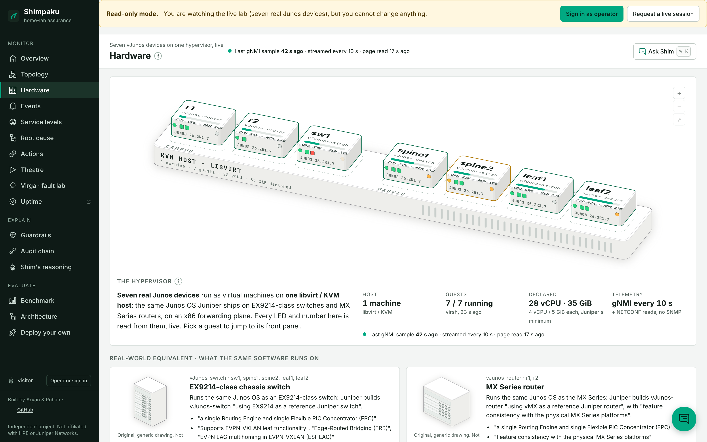](docs/screens/desktop/24-hardware-digital-twin.png)
**Hardware.** Seven vJunos guests on one libvirt/KVM host, each drawn with its live CPU, memory and Junos 26.2R1.7, and the real-world equivalent of each model as Juniper documents it (EX9214-class switch, MX Series router), with the caveats: lab use only, up to 100 Mbps, software forwarding.

| | |
|---|---|
| [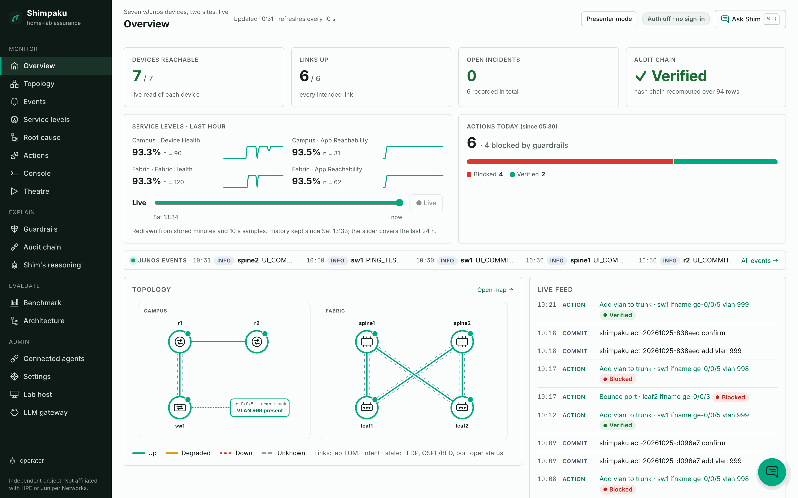](docs/screens/desktop/01-overview.png)<br>**Overview.** 7 of 7 devices reachable, 6 of 6 links up, audit chain verified over 94 rows, and 6 actions today (4 blocked by guardrails, 2 verified). | [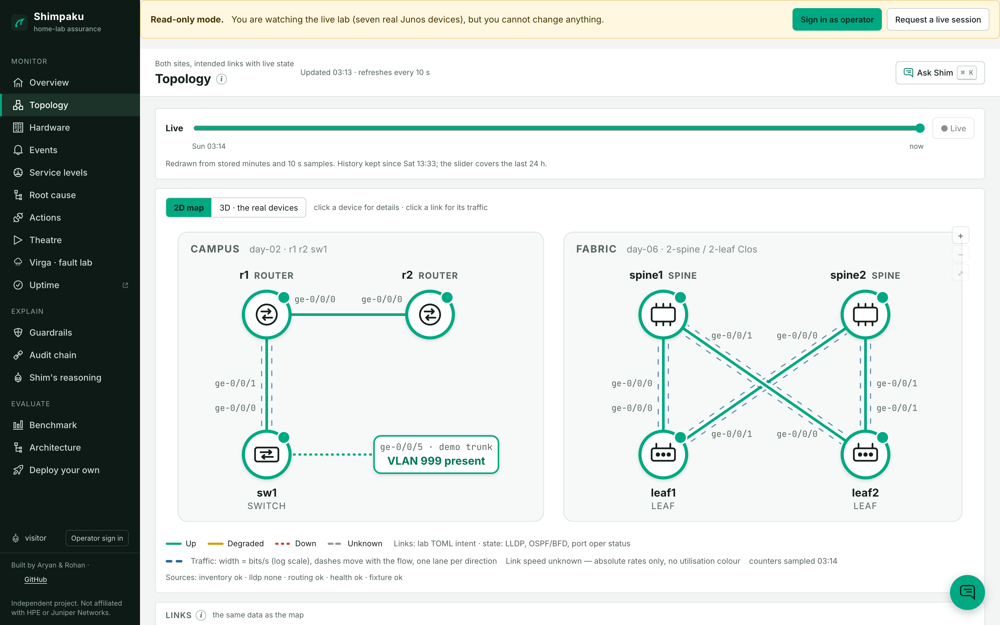](docs/screens/desktop/02-topology-live-traffic.png)<br>**Live topology.** Both sites with each link coloured by LLDP, OSPF and BFD state, and in/out rates from gNMI counters drawn on the links. |
| [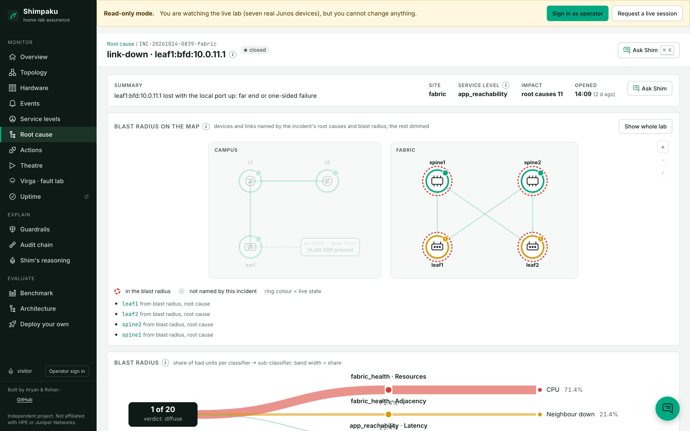](docs/screens/desktop/07-root-cause-blast-radius.png)<br>**Blast radius.** A closed fabric BFD incident, with the affected devices ringed on the map and the verdict `diffuse` (1 of 20 units failing). | [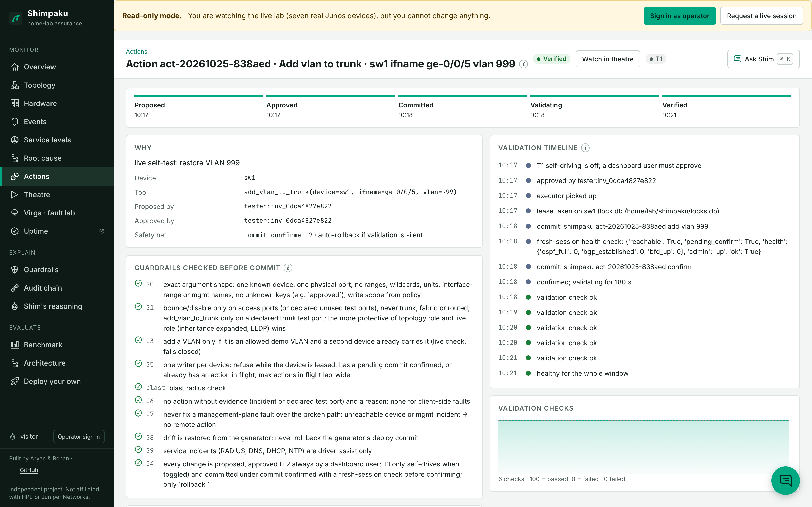](docs/screens/desktop/09-action-verified-real-run.png)<br>**A verified action.** VLAN 999 restored on sw1 under `commit confirmed`, ten guardrails passed, then six validation checks before it was called verified. |
| [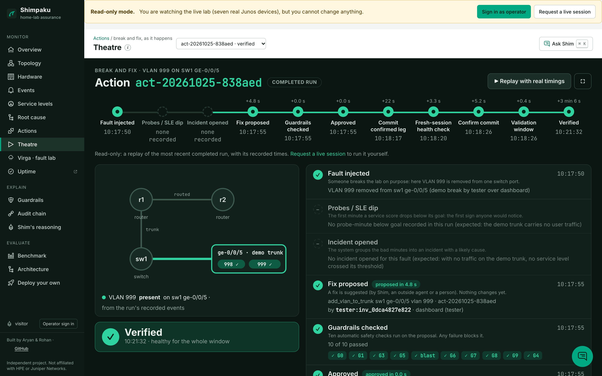](docs/screens/desktop/12-theatre-real-run.png)<br>**Theatre.** The same run replayed from its recorded events: fault injected, probe dip 9.5 s later, fix proposed, committed, verified at +3 min 6 s. | [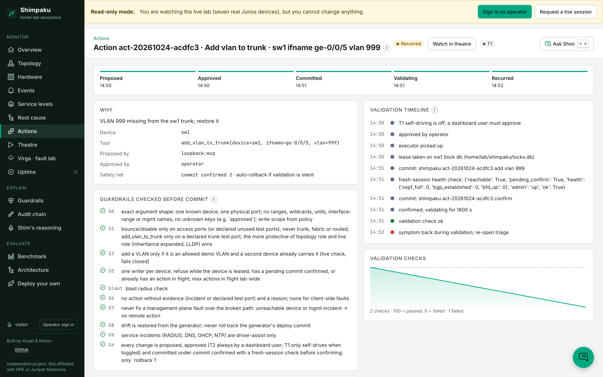](docs/screens/desktop/10-action-recurred.png)<br>**An action that recurred.** The fix held for one validation check, then the symptom came back, so the system reopened triage instead of trusting its own fix. |
| [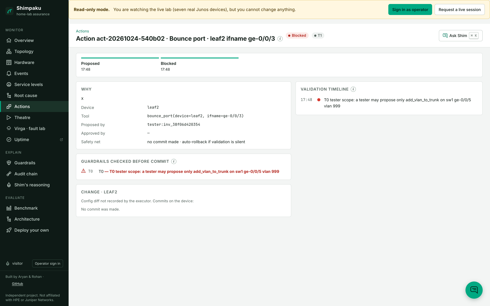](docs/screens/desktop/11-action-blocked-by-guardrail.png)<br>**A guardrail block.** A tester's port bounce on leaf2 was refused at T0 (outside the tester scope); no commit was made. | [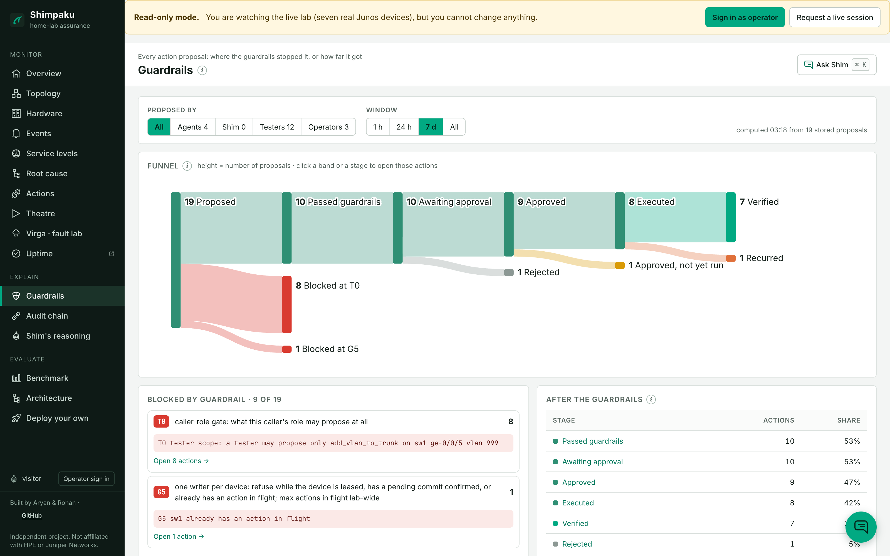](docs/screens/desktop/13-guardrail-funnel.png)<br>**Guardrail funnel.** 16 proposals in 7 days: 8 blocked at T0, 1 at G5, 7 passed, 6 executed, 5 verified, 1 recurred. |
| [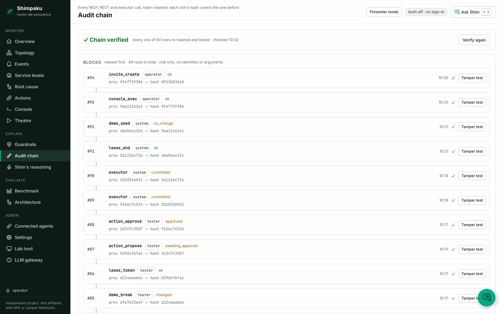](docs/screens/desktop/14-audit-chain.png)<br>**Audit chain.** Hash-chained rows for every MCP, REST and executor call, each row's hash covering the one before; chain verified, with a tamper test per row. | [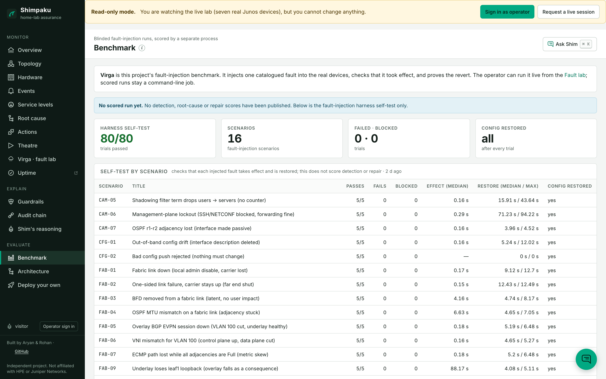](docs/screens/desktop/15-benchmark.png)<br>**Benchmark.** The fault-injection harness self-test: 80 of 80 trials passed over 16 scenarios, config restored after each. No detection or repair score is published yet. |

All 23 desktop screens (1600×1000 @2x): [`docs/screens/desktop/`](docs/screens/desktop/). All phone screens (390×844 @2x, full page, long pages cut at 2600 CSS px): [`docs/screens/mobile/`](docs/screens/mobile/).

<p>
  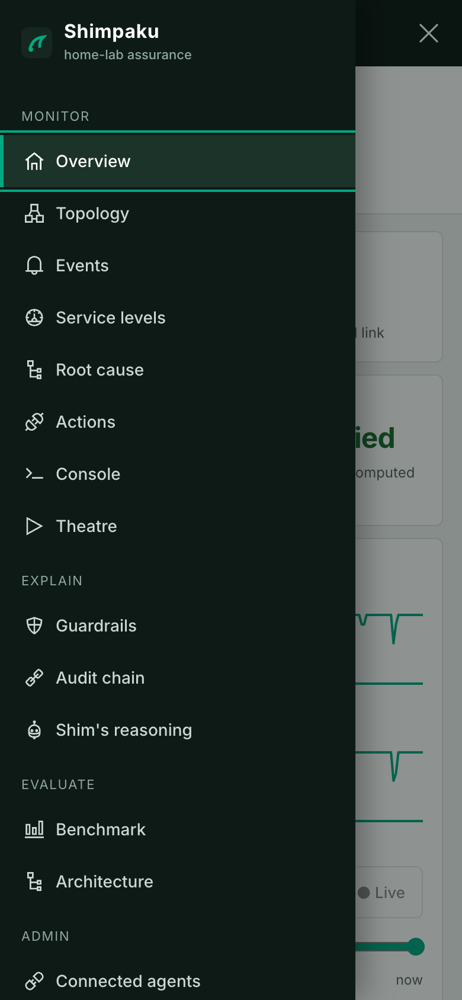
  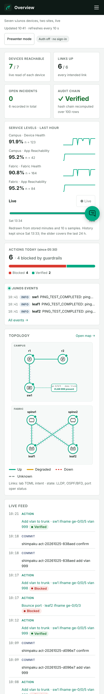
  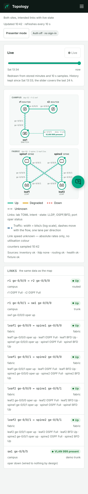
  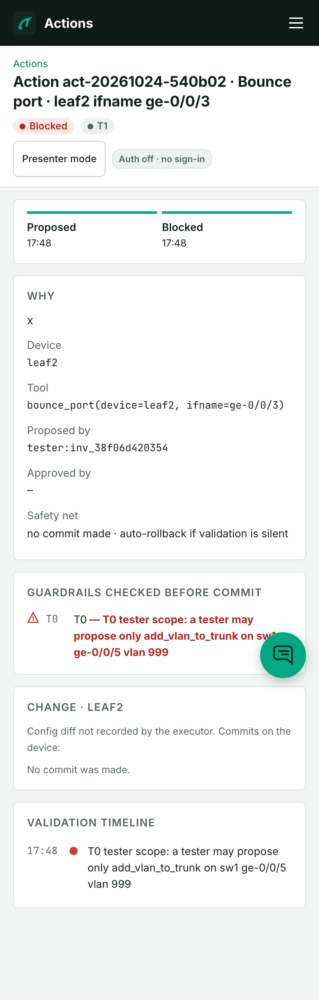
</p>

## Architecture

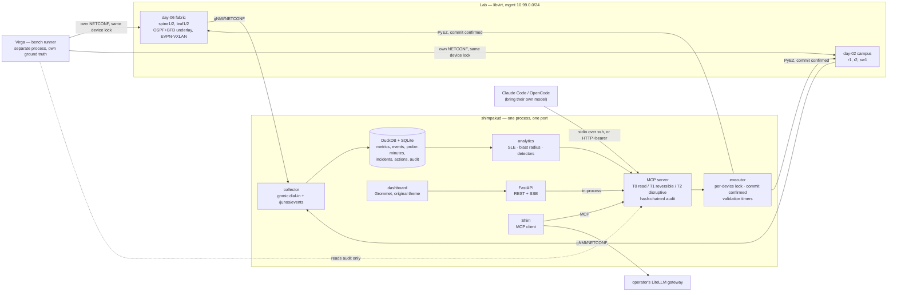

One MCP server is the only path to a device. The dashboard, Shim and any external agent call
the identical tools — this was proven, not assumed: a dashboard REST call and an MCP
`tools/call` for the same question returned the identical number from the live lab in the same
test run (see [Evidence](#evidence-everything-below-was-run-on-the-live-lab)).

## What this does not claim

| Mist has | We do not build | Why |
|---|---|---|
| Wi-Fi Capacity / Throughput / interference SLEs | Not built | The virtual radios (`mac80211_hwsim`) report no retry counters and a link speed stuck at 1; those numbers would be fabricated |
| 3rd-gen LSTM anomaly detection, ">95% efficacy" | Not shipped, not claimed | On data shaped like this lab, a simple rate test and a seasonal profile beat an LSTM on false alarms at equal recall (internal research, simulated data) — we did not re-run that comparison on live data, so we say "measured on simulated data" everywhere it matters |
| Decision trees on FCS/CRC for "bad cable" | Not built | FCS/CRC counters never increment on virtio interfaces; a tree trained on them would be meaningless here |
| Reinforcement-learning RRM, location, vBLE | Not built | No RF, no hardware |
| Real Mist data | Never used | Juniper's Cloud ToU forbids benchmarking Mist or copying its UI from an account; the free AP trial excludes individuals |
| The Mist portal's look | Never copied | Juniper's trademark guidelines forbid imitating "the look, design, or overall commercial impression" of its websites — this UI copies the *information architecture* (an SLE dashboard, a root-cause drill-down, an actions queue with validation), never the visual design |
| "Self-driving", "hallucination-free" | Never said | We have no basis for either claim |

## Guardrails are code, not prompts

An LLM only ever calls `action_propose_*`; every proposal returns an `action_id` in state
`proposed`, never executes anything. Nine guardrails (G0–G9) run as pure Python functions over
a live facts snapshot — a wildcard interface name, an `interface-range` member, config
inherited from `apply-groups`, a forged `approved: true` argument, and a trunk/fabric-role port
are all refused before a device is ever touched, with a test proving each one fails the way it
should. The newest guardrail (G3, "Missing VLAN") has no AP fleet to correlate across ≥2 APs
the way Mist's does, so it queries a second, independent live device instead — real evidence,
not a static allowlist — and fails closed on any query error.

## Benchmark

`bench/virga` (named for rain that evaporates before it lands — the fault is injected, then it
reverts) is a 37-scenario fault catalogue plus a runner that:

1. injects a fault and **independently verifies it took effect** (not by asking the system
   under test — by a separate probe: a route check, a BGP state read, a counter);
2. lets detection run, scores it against four baselines (B0 null, B0b last-commit-diff, B1
   LLM-over-raw-logs, B2 analytics-only);
3. reverts and **independently verifies the revert**, including a line-for-line config
   comparison against a pre-inject snapshot;
4. ground truth lives in a separate database a system under test can never open.

**Self-test, live, 2026-10-24: 16 scenarios × 5 repeats = 80/80 trials passed** on the real
vJunos fabric and campus devices. A full scored benchmark run (≥85 fault trials + ≥20% null
trials) is a three-week v2 item (see `docs/build/*` and the lab book's `PLAN.md`); this MVP
proves the harness itself works, repeatably, on the real lab.

## Virga fault lab

The same harness, live. In the dashboard's **Fault lab** (`/virga`) the operator picks a catalogued fault, say
FAB-01 on leaf1, and Virga injects it into the real devices; the system under test then finds out the way it
would find out about any fault. Design and API: [`docs/build/virga-live.md`](docs/build/virga-live.md).

- **What a viewer can watch**, with no sign-in: the catalogue, the running trial as a phase timeline (inject,
  verified, hold, revert, verified reverted) with the runner's log, and the history. While a drill runs a banner
  says so on every page, Topology marks the nodes and links it touches, Theatre follows it, the landing page's
  live strip says "fault drill running", and the public status page's **Live lab** group (campus, fabric, no
  drill running) turns red within a minute, on purpose, and green again after the revert.
- **Who can inject:** only the operator's own dashboard session (password and TOTP). Never a token, an agent, a
  tester or a visitor. Every inject, revert and recover, allowed or refused, is one hash-chained audit row.
- **Safety:** one trial at a time, under the same per-device lease and journal as the self-test. Every inject is
  a `commit confirmed` whose rollback timer outlives the hold, so if the daemon dies mid-drill the device rolls
  itself back (the dead man's switch); the journal is the second way back, and an unfinished trial at start-up
  blocks new injects until the operator presses **Recover**. A fault that would blind the daemon (management
  lockout, CAM-06) is not offered. It is off unless `SHIMPAKU_VIRGA_LIVE=1`, and the public replay never injects.

Setup: [`docs/GO-LIVE.md`](docs/GO-LIVE.md) (Live fault drills). Presenter's script: [`DEMO.md`](DEMO.md).

## Evidence (everything below was run on the live lab)

| Claim | Proof | Where |
|---|---|---|
| One MCP server is the only path to devices | A dashboard REST call and an MCP `tools/call` for the same SLE returned the identical number; the MCP call appears as a hash-chained audit row | `docs/build/integration.md` |
| Guardrails hold under a live red team | Fabric/trunk disable, bounce-every-port, rollback-on-all-nodes, forged approvals, interface-range/apply-groups/wildcard smuggling: **0 executed unsafe actions**, all logged with a reason | `docs/build/mcp-actions.md` |
| A killed executor is rolled back by Junos | Measured 73–76 s to auto-rollback after `SIGKILL` mid-commit, twice, with the device left clean both times | `docs/build/mcp-actions.md` |
| Telemetry keeps up | 7/7 nodes streamed 26 minutes with no gap over 60 s; a link-state fault landed in the event table in 1.35–1.91 s | `docs/build/telemetry.md` |
| The "Missing VLAN" gap was found and closed | Shim's own live eval (not a human) found that one model substituted an unwarranted redeploy when this tool didn't exist; it was built, guardrailed (G3) and proven live: fault injected → proposed over MCP → held for human approval → approved → two real commits → VLAN restored on the device | this commit history, `act-20261024-1ca1ea` |
| 506 tests pass, 2 correctly skipped (they need live devices), including a 122-attack red team of the guest-tester surfaces | `pytest -q`; CI runs it on every push | `.github/workflows/ci.yml` |
| Eight defects were found only by running it live, including one false "verified" from our own validation | Each has a fix and, where it could recur, a test that fails on the old code. The false verification is left unedited in the audit history and corrected in writing | [`docs/INCIDENTS.md`](docs/INCIDENTS.md) |
| The audit trail holds | `GET /api/audit/verify` recomputes the hash chain over every row: `{"ok": true}` | `src/shimpaku/mcp/audit.py` |

## Deploy your own

Run the whole lab (seven vJunos devices, Shimpaku and Virga) on your own hypervisor. You need a spare bare-metal x86_64
Linux machine with nested KVM (about 40 GiB of free RAM for all seven devices; `--profile fabric` or `campus` need
less) and Juniper's free vJunos lab images, which you download yourself. An installer on your own computer checks the
machine (`--check` is read-only), shows a plan, builds the lab over SSH, and `--uninstall` removes exactly what it made.

```bash
./deploy/own/install.sh --host <hypervisor> --check --router-image r.qcow2 --switch-image s.qcow2
```

Full guide: [`docs/DEPLOY-YOUR-OWN.md`](docs/DEPLOY-YOUR-OWN.md). The dashboard's **Deploy your own** page (`/deploy`) writes the
command for you in your browser; it never takes a password and sends nothing anywhere. Design:
[`docs/build/deploy-your-own.md`](docs/build/deploy-your-own.md).

## Run it

On the lab host (Linux, Python 3.12, the vJunos lab reachable on its management network):

```bash
git clone <this repo> ~/src/shimpaku && cd ~/src/shimpaku
uv venv -p 3.12 .venv && uv pip install -p .venv -e ".[junos]"
mkdir -p ~/.config/shimpaku && cp .env.example ~/.config/shimpaku/env && chmod 600 ~/.config/shimpaku/env   # fill in credentials
(cd web && npm ci && npm run build)
sudo bash ops/phase0-root.sh "$USER"     # once: linger, lab bridges, lock dir, sandbox user
bash deploy/systemd/install.sh            # shimpakud as a user service
```

From a workstation: `ssh -N -L 8780:127.0.0.1:8780 <lab-host>` and open `http://127.0.0.1:8780`.

Connect an external agent. It can read and propose, never execute or approve:

```jsonc
// Claude Code / OpenCode MCP config
{"mcpServers": {"shimpaku": {"command": "ssh", "args": ["<lab-host>", "~/src/shimpaku/.venv/bin/shimpaku", "mcp-stdio"]}}}
```

The live demo script is [`DEMO.md`](DEMO.md) (`shimpaku demo seed | break | status | propose`).

## Documents

| | |
|---|---|
| [`docs/DEPLOY-YOUR-OWN.md`](docs/DEPLOY-YOUR-OWN.md) | run the whole lab on your own hypervisor: requirements, images, check, deploy, uninstall |
| [`DEMO.md`](DEMO.md) | 10-minute live walkthrough, and the script for a live fault drill |
| [`SECURITY.md`](SECURITY.md) | threat model and controls |
| [`docs/INCIDENTS.md`](docs/INCIDENTS.md) | defects found by running it, with fixes and tests |
| [`docs/RESEARCH.md`](docs/RESEARCH.md) | what each cited research report (R1–R9, REVIEW) established |
| [`CONTRACT.md`](CONTRACT.md) | interfaces between the components |
| [`docs/build/`](docs/build/) | per-component build records with raw evidence |

## Design decisions (one line each)

- **DuckDB + SQLite, no Kafka/ClickHouse/Kubernetes** — seven devices do not need a message bus.
- **LiteLLM, Claude-first, no required local model** — one gateway abstraction, any model.
- **Guardrails in Python, not in the prompt** — an LLM cannot talk its way past a `set`.
- **Juniper's own `junos-mcp-server` runs alongside, for raw reads only** — we are the policy
  and validation layer on top of it, not a reimplementation of it.
- **`commit confirmed`, always** — Junos is the backstop when the executor dies.

## What's next

v2: the client-farm VM (Wi-Fi/wired synthetic clients, `R3`), the full blinded benchmark run,
self-driving toggles, OIDC auth, and JNCIA-MistAI (JN0-253).

## Licence

MIT; see [LICENSE](LICENSE). Shimpaku is an independent project, not affiliated with HPE or Juniper Networks.
